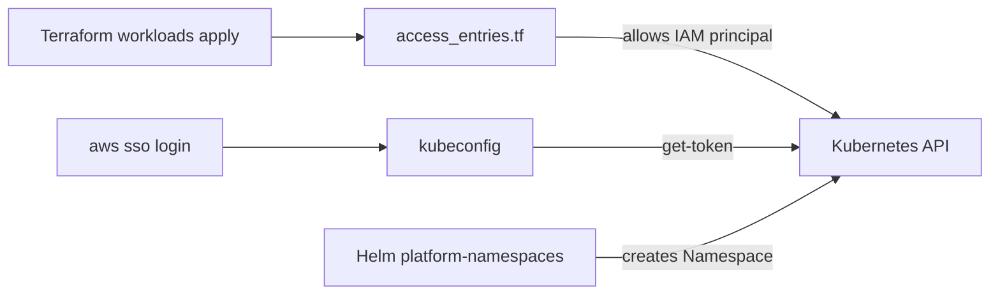
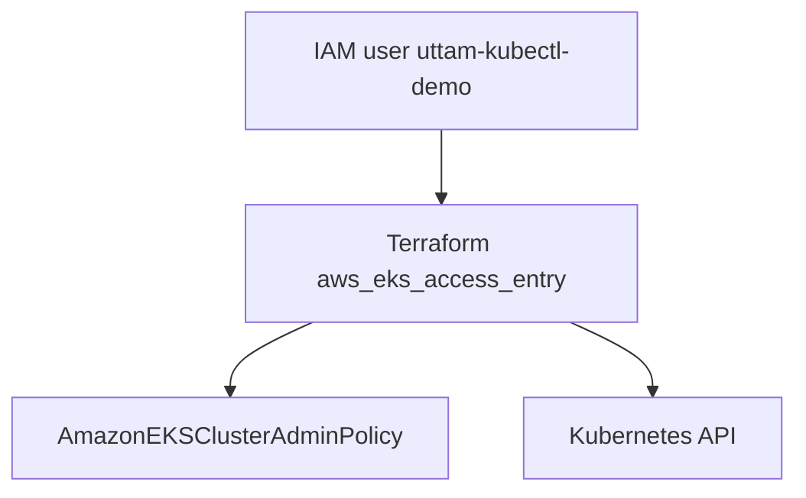

# Connect to EKS and deploy namespaces

Cluster: **`kong-ai-dev`** · Region: **`us-east-2`** · Account: **`593024667763`**

**Split:** access entries = **Terraform**. Namespaces = **Helm**. No `aws eks create-access-entry` in scripts.

Full comparison (EKS vs GKE vs OpenShift): **[NAMESPACE-AUTOMATION.md](NAMESPACE-AUTOMATION.md)**.



---

## Order

1. **Terraform apply** (HCP) — cluster + `kubectl_admin_principal_arns` access entries
2. **AWS login** on laptop — `aws sso login`
3. **`./aws/helm/namespace/install.sh`** — kubeconfig + Helm namespaces

---

## What kubeconfig is

File on this laptop: `~/.kube/config`. Tells kubectl the cluster URL and to use `aws eks get-token`. **Not in git.**

| | Need kubeconfig? |
| --- | --- |
| Terraform apply in HCP | No |
| Helm / kubectl on laptop | **Yes** |

AWS login alone is not enough.

---

## What an EKS access entry is

AWS object on the cluster: which **IAM user/role** may call the Kubernetes API.

Managed in **Terraform** (`aws/terraform/workloads/dev/infra/access_entries.tf`), not Helm, not `install.sh`.



Default principal (workspace variable):

```hcl
kubectl_admin_principal_arns = [
  "arn:aws:iam::593024667763:user/uttam-kubectl-demo"
]
```

Without this apply, `kubectl get ns` returns **Unauthorized**.

Console: EKS → `kong-ai-dev` → **Access** tab.

---

## Deploy namespaces

```bash
./aws/helm/namespace/install.sh
```

Creates:

| Namespace | Purpose |
| --- | --- |
| `argocd` | Argo CD |
| `kong-ai-gateway` | Kong + Istio injection |

Helm chart: `aws/helm/namespace/`. Release name `platform-namespaces` in `kube-system`.

---

## If kubectl says Unauthorized

1. Check your ARN: `aws sts get-caller-identity`
2. Add that principal to `kubectl_admin_principal_arns` in Terraform
3. Re-apply workloads workspace
4. Re-run `install.sh`

---

## Verify

```bash
kubectl get ns
kubectl get namespace argocd kong-ai-gateway -o yaml
```

Next: `./aws/helm/argocd/install.sh`
