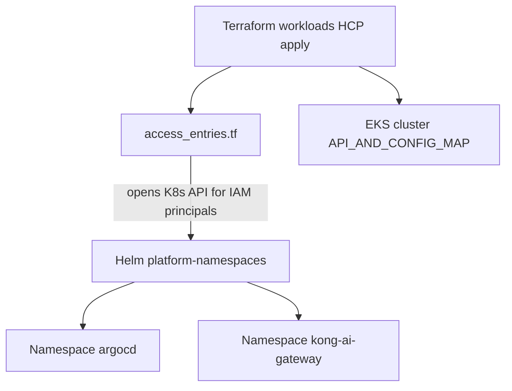
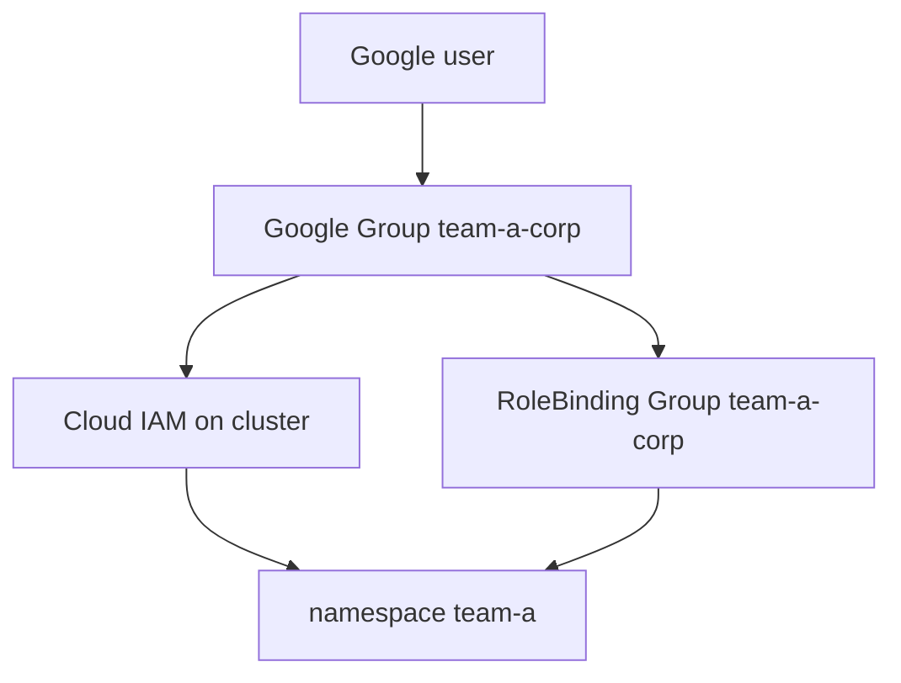
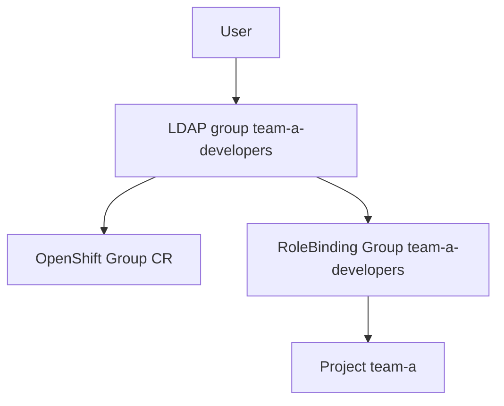
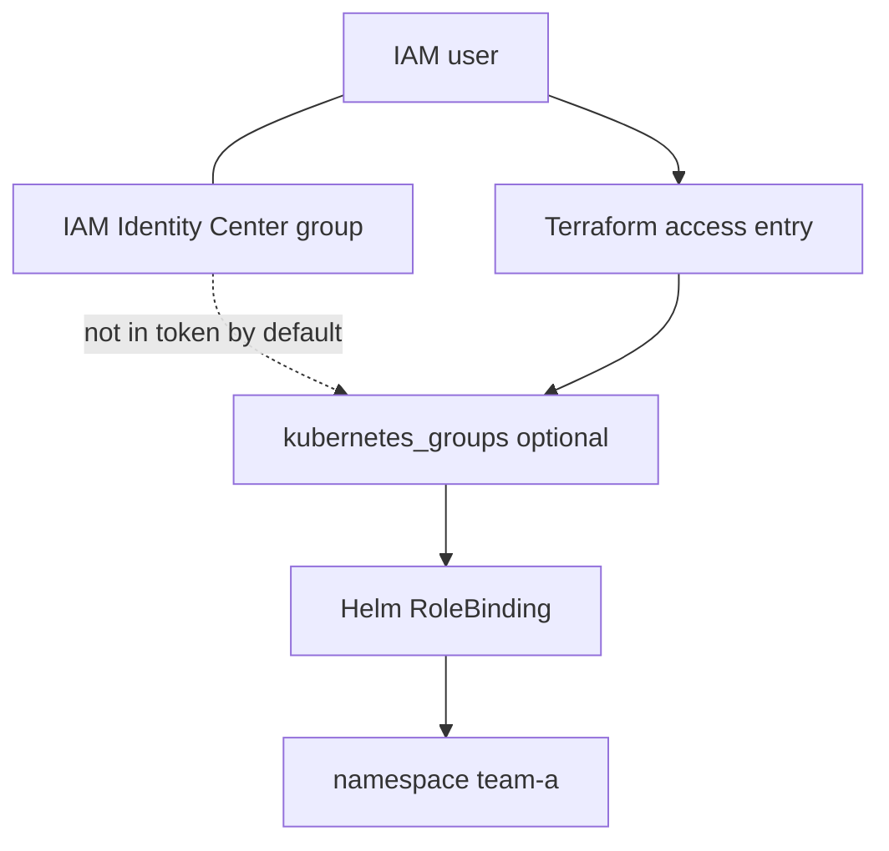
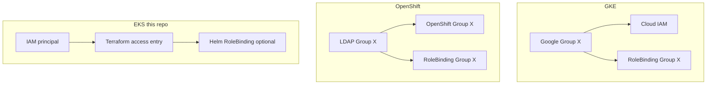

# EKS vs GKE vs OpenShift — groups, RoleBinding, namespace automation

**Goal:** automate namespace creation with **Terraform** (access entries) + **Helm** (namespaces). No `aws eks create-access-entry` in scripts.

Cluster: **`kong-ai-dev`** · connect: **[CONNECT.md](CONNECT.md)**.

---

## Short answer — EKS extra step

| Platform | Same group for login + RoleBinding? |
| --- | --- |
| **GKE** | **Yes** — Google Group in Cloud IAM **and** RoleBinding |
| **OpenShift** | **Yes** — LDAP group synced to OpenShift Group, same name in RoleBinding |
| **EKS** | **Not by default** — IAM group ≠ Kubernetes group unless Terraform maps `kubernetes_groups` on the access entry |

EKS has **one extra step**: **access entry** (Terraform) before RoleBinding works like GKE/OpenShift.

---

## Automate namespaces — Terraform + Helm (this repo)



| Layer | Tool | File |
| --- | --- | --- |
| Cluster + auth mode | **Terraform** | `infra/eks.tf` |
| Access entries | **Terraform** | `infra/access_entries.tf` |
| Namespaces | **Helm** | `aws/helm/namespace/` |
| RoleBinding per team | **Helm** (future) | add to chart or team values |
| kubeconfig | Local only | `install.sh` calls `update-kubeconfig` |

**Do not** put access entries in Helm. **Do not** put namespaces in Terraform.

---

## Terraform — access entry (cluster admin)

Variable in `aws/terraform/workloads/dev/variables.tf`:

```hcl
variable "kubectl_admin_principal_arns" {
  type        = list(string)
  description = "IAM user or role ARNs that may kubectl/Helm."
  default     = ["arn:aws:iam::593024667763:user/uttam-kubectl-demo"]
}
```

Resource in `aws/terraform/workloads/dev/infra/access_entries.tf`:

```hcl
resource "aws_eks_access_entry" "kubectl_admin" {
  for_each = toset(var.kubectl_admin_principal_arns)

  cluster_name  = aws_eks_cluster.this.name
  principal_arn = each.value
  type          = "STANDARD"
}

resource "aws_eks_access_policy_association" "kubectl_admin" {
  for_each = toset(var.kubectl_admin_principal_arns)

  cluster_name  = aws_eks_cluster.this.name
  principal_arn = each.value
  policy_arn    = "arn:aws:eks::aws:cluster-access-policy/AmazonEKSClusterAdminPolicy"

  access_scope {
    type = "cluster"
  }

  depends_on = [aws_eks_access_entry.kubectl_admin]
}
```

Cluster auth mode in `infra/eks.tf`:

```hcl
access_config {
  authentication_mode = "API_AND_CONFIG_MAP"
}
```

Apply via HCP workspace `kong-ai-gateway-aws-workload`. Then locally:

```bash
aws eks update-kubeconfig --name kong-ai-dev --region us-east-2
./aws/helm/namespace/install.sh
```

---

## Helm — namespace objects

**values.yaml:**

```yaml
namespaces:
  argocd:
    name: argocd
  kongAiGateway:
    name: kong-ai-gateway
    labels:
      istio-injection: enabled
```

**Install:**

```bash
helm upgrade --install platform-namespaces aws/helm/namespace \
  --namespace kube-system \
  --wait
```

Add a namespace: new template + values entry → `helm upgrade`. Or Argo CD later.

---

## Terraform — team access (RoleBinding pattern)

**Option A — map IAM role to Kubernetes group** (like GKE/OpenShift):

```hcl
resource "aws_eks_access_entry" "team_a" {
  cluster_name      = aws_eks_cluster.this.name
  principal_arn     = "arn:aws:iam::593024667763:role/team-a-deploy"
  type              = "STANDARD"
  kubernetes_groups = ["team-a-developers"]
}
```

**Helm RoleBinding** (same YAML on all platforms):

```yaml
apiVersion: rbac.authorization.k8s.io/v1
kind: RoleBinding
metadata:
  name: team-a-editors
  namespace: team-a
subjects:
  - kind: Group
    name: team-a-developers
roleRef:
  kind: ClusterRole
  name: edit
  apiGroup: rbac.authorization.k8s.io
```

**Option B — namespace-scoped access policy** (no RoleBinding):

```hcl
resource "aws_eks_access_policy_association" "team_a_edit" {
  cluster_name  = aws_eks_cluster.this.name
  principal_arn = "arn:aws:iam::593024667763:user/alice"
  policy_arn    = "arn:aws:eks::aws:cluster-access-policy/AmazonEKSEditPolicy"

  access_scope {
    type       = "namespace"
    namespaces = ["team-a"]
  }

  depends_on = [aws_eks_access_entry.team_a]
}
```

---

## GKE — one Google Group end to end



Same group name in IAM and RoleBinding. No separate Kubernetes group.

---

## OpenShift — one LDAP group end to end



---

## EKS — extra mapping step



---

## Side by side



| | **GKE** | **OpenShift** | **EKS** |
| --- | --- | --- | --- |
| API gate | Cloud IAM | OAuth User | **Terraform access entry** |
| Same name in RoleBinding? | **Yes** | **Yes** | **Only with kubernetes_groups** |
| Namespace | Helm / GitOps | ProjectRequest | **Helm chart** |
| Automate access | Cloud IAM binding | LDAP sync | **Terraform** |
| Automate namespace | Helm | GitOps | **Helm** |

---

## Checklist

| Step | Tool |
| --- | --- |
| EKS cluster + auth mode | Terraform apply |
| Access entry for your IAM user | Terraform `kubectl_admin_principal_arns` |
| kubeconfig | `install.sh` or manual |
| Namespaces argocd + kong-ai-gateway | Helm `install.sh` |
| Team RoleBinding | Helm template (future) |
