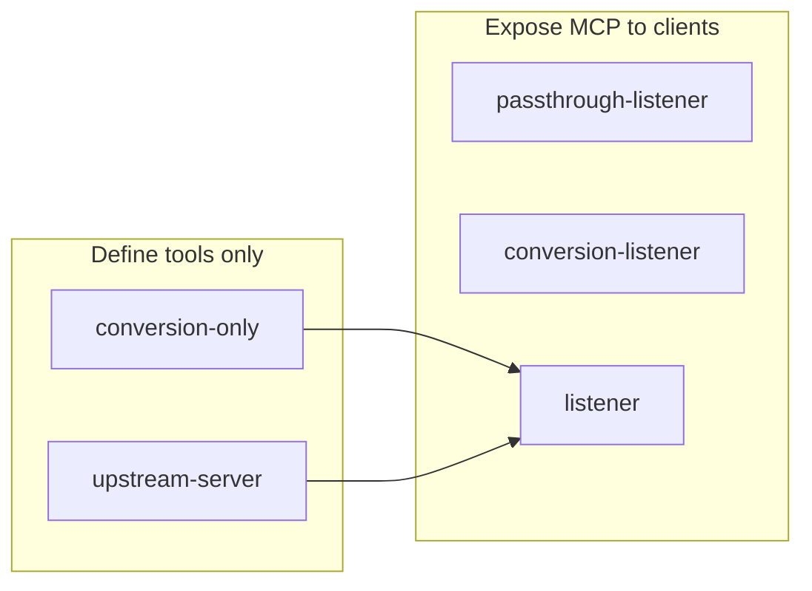
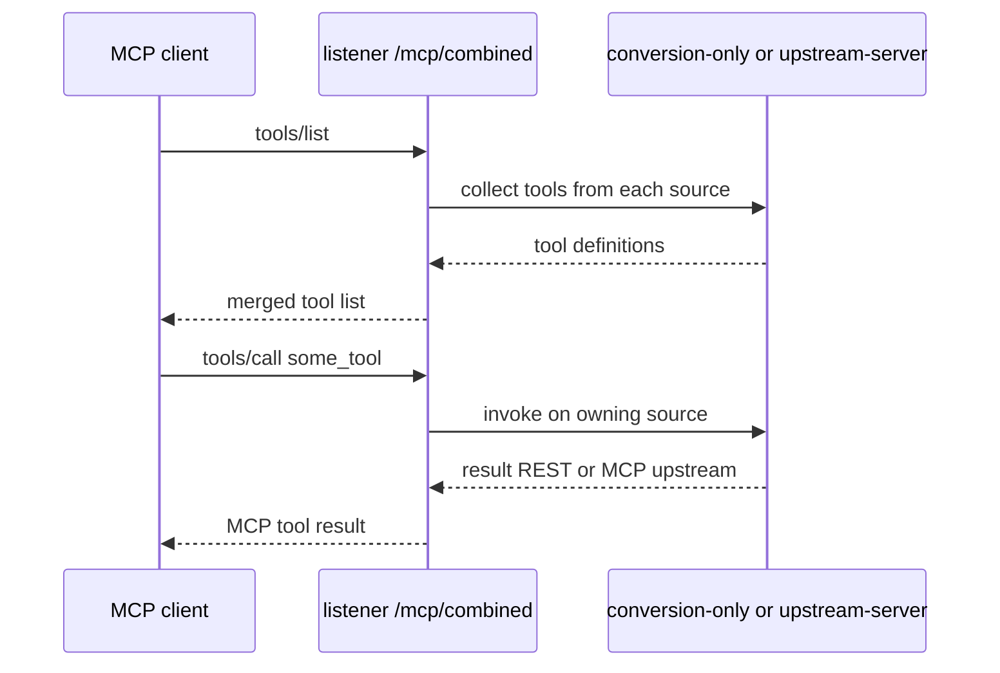
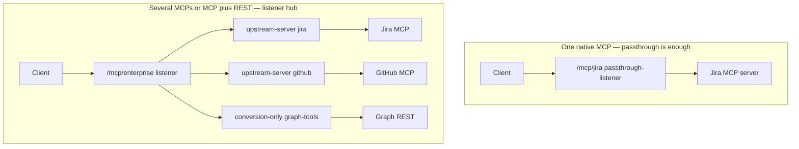
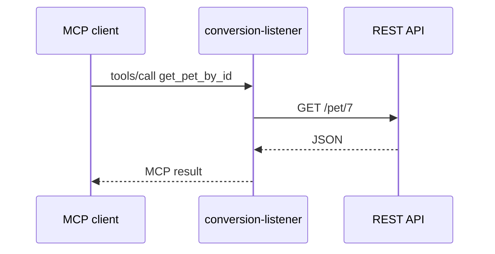
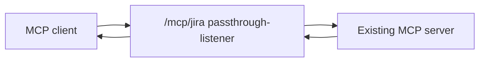
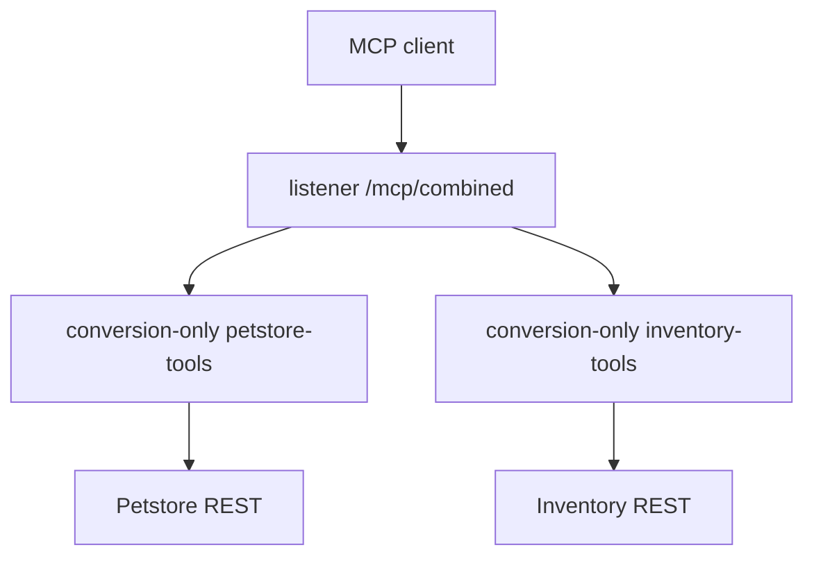
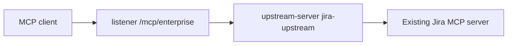
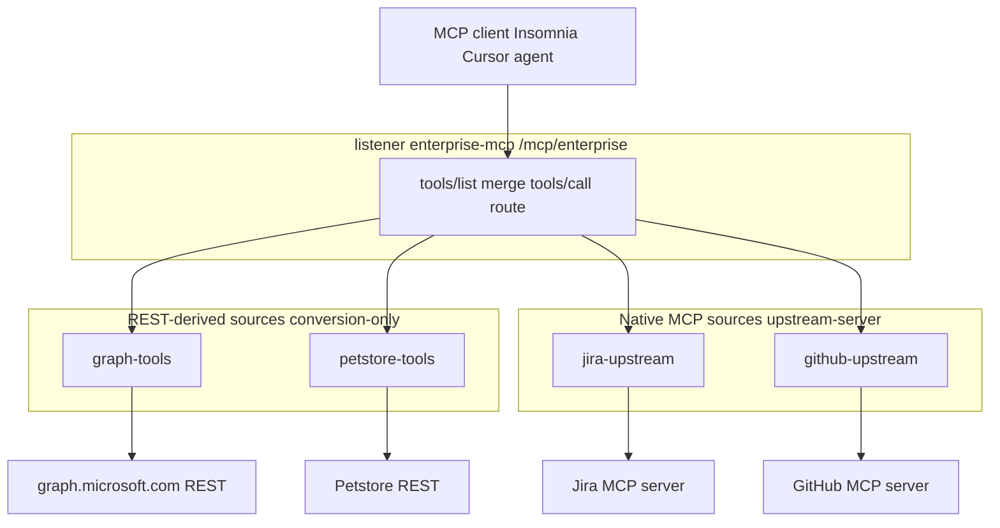
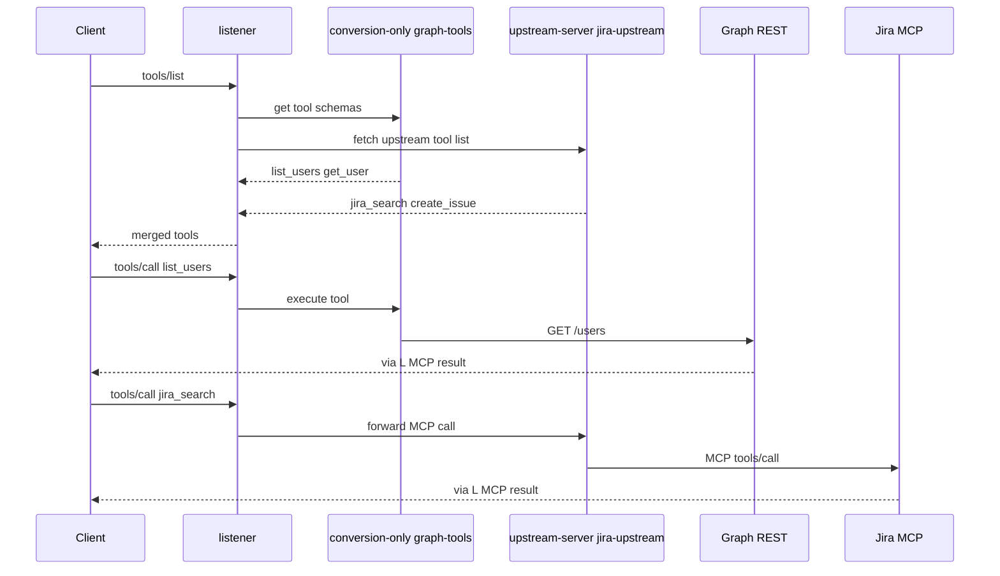

# AI Gateway MCP — five server types

**AI Gateway 2.x** (playground 2.2 included): you configure an **AI MCP Server** entity. The data plane still runs **`ai-mcp-proxy`** (Service + Route + plugin) unless Kong generates it for you.

**Petstore lab (Conversion Listener):** [`examples/petstore-mcp-server-2.1.yaml`](examples/petstore-mcp-server-2.1.yaml)

Terminology: **`conversion-listener`** (REST → MCP tools), not “conversation listener.”

This repo’s EKS [`kong.yml`](kong.yml) has no MCP; apply examples on your gateway or `deck file ai2kong` for self-hosted Kong.

**Konnect UI (where to click, no separate registry):** **[MCP-KONNECT-UI.md](MCP-KONNECT-UI.md)** · **Enterprise hub / on-prem:** **[MCP-ENTERPRISE-REGISTRY.md](MCP-ENTERPRISE-REGISTRY.md)**

---

## Two layers (same runtime)

| Layer | What you edit |
| --- | --- |
| **AI Gateway 2.x** | **AI MCP Server** — `type`, `config`, `tools`, optional `sources` |
| **Traditional Kong** | **Service + Route + `ai-mcp-proxy`** (`mode` matches `type`) |

Konnect / entity control plane: you define the MCP Server; Kong materializes the plugin config. OpenShift with decK only: **`deck file ai2kong`** from the same entity YAML, or hand-write the plugin.

[Configure AI Gateway on-prem](https://developer.konghq.com/ai-gateway/configure-on-prem/) · [AI MCP Server entity](https://developer.konghq.com/ai-gateway/entities/ai-mcp-server/)

---

## 1. How the five types differ

| Type | Exposes MCP endpoint | Converts REST → MCP | Main purpose |
| --- | --- | --- | --- |
| **Passthrough Listener** | Yes | No | Proxy an **existing** MCP server |
| **Conversion Listener** | Yes | Yes | **Your Petstore playground** — one REST API, one MCP URL |
| **Conversion Only** | No (not by itself) | Yes | Tool definitions for a **Listener** |
| **Listener** | Yes | No (aggregates others) | **One MCP URL** combining sources |
| **Upstream Server** | No (not by itself) | No | Register an **existing MCP server** for a **Listener** |



### Listener — what the table row means

The **Listener** row looks odd next to **Conversion Listener** because the listener **does not convert REST itself**. It **publishes one MCP endpoint** and **delegates** work to **`sources`**.

| Column | Meaning for **Listener** |
| --- | --- |
| **Exposes MCP endpoint — Yes** | Clients connect to **`config.route.paths`** (e.g. `/mcp/combined`). They send normal MCP traffic: `initialize`, **`tools/list`**, **`tools/call`**. Insomnia uses this URL only. |
| **Converts REST → MCP — No (aggregates others)** | The listener entity has **no `tools[]`** and **no `config.url`** for a REST API. REST→tool mapping lives in **`conversion-only`** sources. Native MCP tool catalogs live in **`upstream-server`** sources. The listener **merges** those catalogs and **routes** each call; it does not turn HTTP paths into tools on its own. |
| **One MCP URL combining sources** | Top-level **`sources: [petstore-tools, inventory-tools, …]`** lists other MCP Server entities by **`name`**. One hub URL replaces many URLs for clients. |



**Listener vs Conversion Listener in one line:** **Conversion Listener** = “this route **is** the REST→MCP server.” **Listener** = “this route **is** the front desk; tools come from **named sources** behind it.”

You cannot put a **Conversion Listener** in **`sources`** — only **`conversion-only`** and **`upstream-server`**. If you need one REST API and one URL with no extra entities, use **Conversion Listener** (Petstore), not Listener.

**Listener rules (Kong docs):**

- `sources` lists immutable **`name`** values of **`conversion-only`** and/or **`upstream-server`** servers only — **not** `conversion-listener`.
- A **`listener`** has no `config.url`; it routes **`tools/call`** to the right source.
- **`conversion-only`** tools are reachable only through listeners that name them in `sources`.

**On-prem self-hosted Kong:** **`upstream-server`** has **no** full plugin equivalent; aggregation of native MCP upstreams is a **2.x entity / Konnect** pattern. REST **`conversion-listener`** converts via `ai-mcp-proxy` as documented.

### Konnect playground vs on-prem (same idea, different control plane)

| | Konnect / AI Gateway 2.x playground | On-prem (OpenShift / self-hosted Kong) |
| --- | --- | --- |
| Control plane | Konnect SaaS (or entity CP) | Self-managed |
| Data plane | Docker / K8s | Your cluster |
| MCP **Conversion Listener** | Yes | Yes (via entity or `ai2kong` → `ai-mcp-proxy`) |
| Separate MCP **process** required | No | No |
| Typical backend | Petstore REST, Graph REST | Same |
| How you configure | UI / `kongctl` **AI MCP Server** | Same entity file, or decK plugin YAML |

Entity **`petstore-mcp`** in the playground becomes **Service + Route + `ai-mcp-proxy`** on the data plane in both cases.

---

## 2. Passthrough vs Listener — which “front door”?

**Passthrough is already a front door** when you have **one** native MCP server (Jira only, GitHub only).

**Upstream Server + Listener** is the front door when you need **one client URL** for **many** backends (several MCP servers and/or REST **conversion-only** toolsets).

| Question | Answer |
| --- | --- |
| One Jira MCP, one team | **Passthrough Listener** on `/mcp/jira` — done |
| Jira MCP + GitHub MCP + Graph REST tools, one Insomnia URL | **Listener** on `/mcp/enterprise` with **`sources`**: upstream-server(s) + conversion-only |
| Is passthrough wrong for Jira? | No — it is the right pattern for **1:1** proxy |
| Why not three passthrough routes? | Works, but clients configure **three URLs** and **three** auth policies; listener **merges** `tools/list` |

| | **Passthrough Listener** | **Upstream Server + Listener** |
| --- | --- | --- |
| Backends | **1** MCP per entity | **Many** in `sources` |
| Client connects to | `/mcp/jira` (per server) | `/mcp/enterprise` (single hub) |
| **`tools/list`** | From that upstream | **Merged** from all sources |
| **`tools/call`** | Always that upstream | Routed to owning source |



---

## 3. Conversion Listener — Petstore (what you used)

**Use when:** One REST API (Microsoft Graph, Petstore, internal API) should appear as MCP tools on **one path**.

| Inbound | Outbound |
| --- | --- |
| MCP on `config.route.paths` (e.g. `/petstore`) | HTTP to `config.url` per tool |

Entity YAML (`kongctl` often uses root key **`ai_gateway_mcp_servers`**):

```yaml
type: conversion-listener
config:
  url: https://petstore3.swagger.io/api/v3
  route:
    paths:
      - /petstore
tools:
  - name: get_pet_by_id
    method: GET
    path: /petstore/pet/{petId}   # include route prefix in entity YAML
    parameters:
      - name: petId
        in: path
        required: true
        schema:
          type: integer
```

| Client step | Behavior |
| --- | --- |
| **`tools/list`** | Tools from `tools[]` |
| **`tools/call`** | e.g. **`path_petId: 7`** → `GET .../api/v3/pet/7` |
| Insomnia | **MCP Clients** → `https://GATEWAY/petstore` |



Apply: [`examples/petstore-mcp-server-2.1.yaml`](examples/petstore-mcp-server-2.1.yaml).

---

## 4. Passthrough Listener

**Use when:** Backend is already MCP (Jira MCP, DeepWiki, etc.), not plain REST.

```yaml
# Illustrative — validate against your 2.x schema; add ai_gateway / !lookup for kongctl
type: passthrough-listener
config:
  url: https://mcp.example.com/mcp    # real MCP endpoint
  route:
    paths:
      - /mcp/jira
```



Kong **forwards** MCP; it does **not** invent tools from REST. Upstream may still require its own token (e.g. GitHub PAT). See **[§2 Passthrough vs Listener](#2-passthrough-vs-listener--which-front-door)** when choosing between this and aggregation.

---

## 5. Conversion Only + Listener

**Use when:** Multiple REST APIs (Graph, inventory, ServiceNow) should appear on **one** MCP URL.

Two **`conversion-only`** toolsets + one **`listener`**:

```yaml
# Conceptual ai.yaml — verify fields for your build before apply
mcp_servers:
  - name: petstore-tools
    type: conversion-only
    config:
      url: https://petstore3.swagger.io/api/v3
    tools:
      - name: get_pet_by_id
        method: GET
        path: /pet/{petId}          # no public route prefix on conversion-only
        parameters:
          - name: petId
            in: path
            required: true
            schema:
              type: integer

  - name: inventory-tools
    type: conversion-only
    config:
      url: https://api.example.com
    tools:
      - name: get_inventory
        method: GET
        path: /inventory

  - name: combined-mcp
    type: listener
    sources:
      - petstore-tools
      - inventory-tools
    config:
      route:
        paths:
          - /mcp/combined
```



**Why not two Conversion Listeners?** You can, but clients need **two URLs**. **Conversion Only + Listener** → **one** enterprise endpoint.

Duplicate tool names across sources may get **prefixed** (e.g. `inventory-tools/get_inventory`).

---

## 6. Upstream Server + Listener

**Use when:** **Two or more** native MCP servers (or MCP + REST toolsets) and **one** hub URL — **not** for a single MCP (**use [§4 passthrough](#4-passthrough-listener)**).

```yaml
mcp_servers:
  - name: jira-upstream
    type: upstream-server
    config:
      url: https://jira-mcp.example.com/mcp

  - name: enterprise-mcp
    type: listener
    sources:
      - jira-upstream
    config:
      route:
        paths:
          - /mcp/enterprise
```



**`upstream-server`** registers the backend and supplies tools to the listener; clients **do not** call the upstream URL directly. The **listener** runs **`tools/list`** (merge) and **`tools/call`** (route).

Add more **`sources`** (extra `upstream-server` or **`conversion-only`**) when the listener should expose more than one backend. Configure **`config.server.tools_list_auth`** on upstream-server when the remote MCP requires credentials to fetch tools.

### Listener with mixed `sources` (REST + native MCP on one URL)

Still **`type: listener`** — not a separate mode. **`sources`** mixes **`conversion-only`** (REST→tools) and **`upstream-server`** (native MCP) in any combination Kong allows.

#### What the client sees

| Step | Behavior |
| --- | --- |
| Connect | Single MCP URL, e.g. `https://gateway/mcp/enterprise` |
| **`tools/list`** | One merged catalog: Graph REST tools + Jira MCP tools + … |
| **`tools/call`** | Kong picks the **owning source** and executes REST or forwards MCP |

Clients **never** configure Graph REST URLs or Jira MCP URLs — only the **listener** path and **inbound** credentials (API key / OIDC on the listener).

#### Architecture





#### Example YAML (three sources on one listener)

```yaml
# Illustrative — validate schema, ai_gateway refs, and upstream auth on your 2.x build

mcp_servers:
  # Squad A: Microsoft Graph as REST tools (no public MCP route on this entity)
  - name: graph-tools
    type: conversion-only
    config:
      url: https://graph.microsoft.com/v1.0
      # upstream Entra / token: per Kong docs on conversion-only upstream auth
    tools:
      - name: list_users
        description: List users
        method: GET
        path: /users
        parameters: []  # add $top, $filter as needed

  # Squad B: internal inventory REST API
  - name: inventory-tools
    type: conversion-only
    config:
      url: https://inventory.internal/api
    tools:
      - name: get_stock
        method: GET
        path: /stock/{sku}
        parameters:
          - name: sku
            in: path
            required: true
            schema:
              type: string

  # Squad C: team already ships Jira MCP
  - name: jira-upstream
    type: upstream-server
    config:
      url: https://jira-mcp.example.com/mcp
      server:
        tools_list_auth: {}  # set when upstream requires auth to list tools

  # Platform: single agent-facing hub
  - name: enterprise-mcp
    type: listener
    enabled: true
    sources:
      - graph-tools
      - inventory-tools
      - jira-upstream
    access:
      auth_strategies:
        - enterprise-mcp-key-auth   # one inbound policy on the hub
      acl_attribute_type: consumer
    config:
      route:
        paths:
          - /mcp/enterprise
```

**Order in `sources`** does not change the public URL; it can affect merge order or debugging. **`name`** values must match the source entities exactly (immutable names).

#### Three authentication layers (easy to confuse)

| Layer | Where configured | Protects |
| --- | --- | --- |
| **Inbound MCP** | **`listener`** `access.auth_strategies` | Client → Kong (`apikey`, OIDC) |
| **REST upstream** | **`conversion-only`** upstream auth / vault | Kong → Graph, inventory HTTP |
| **MCP upstream** | **`upstream-server`** `tools_list_auth` + call-time upstream creds | Kong → Jira MCP server |

Graph **Bearer** is **not** the same as the Insomnia **apikey** to Kong. Each **`conversion-only`** / **`upstream-server`** carries its own outbound story.

#### Tool names and collisions

| Situation | Typical behavior |
| --- | --- |
| Unique tool names across sources | Client sees flat names in **`tools/list`** |
| Same name in two sources | Kong may **prefix** with source name (e.g. `inventory-tools/get_stock`) — check your version’s docs |
| Renaming at hub | Prefer unique **`name`** in each source’s tools; avoid relying on prefixes in agent prompts |

Agents and Insomnia should use the **exact** name returned by **`tools/list`** after merge.

#### Who owns what (team model)

| Owner | Entity | Change triggers |
| --- | --- | --- |
| Platform / API COE | **`listener`** + inbound auth + route path | New hub URL, global ACL |
| Integration squad | **`conversion-only`** + `tools[]` for their REST API | New REST operation → new tool |
| MCP product squad | **`upstream-server`** pointing at their MCP URL | Upgrade MCP server; Kong refreshes tool cache |

Adding a squad is usually: create **`conversion-only`** or **`upstream-server`**, then append one string to **`enterprise-mcp.sources`** (reviewed PR).

#### Mixed `sources` vs other patterns

| Approach | URLs for clients | REST→MCP | Native MCP |
| --- | --- | --- | --- |
| **Mixed listener** | **1** | Via `conversion-only` in `sources` | Via `upstream-server` in `sources` |
| **Conversion Only + Listener** (REST only) | 1 | Yes | No |
| **Upstream + Listener** (MCP only) | 1 | No | Yes |
| **Several Conversion Listeners** | 1 per API | Yes, each route | No |
| **Passthrough per MCP** | 1 per MCP server | No | Proxy only |

#### When to use mixed `sources`

| Good fit | Poor fit |
| --- | --- |
| Enterprise agents must use **one** MCP config block | Only Graph REST — use **Conversion Listener** |
| Mix of **REST APIs without MCP** and **teams with MCP already** | Only one native MCP — **Passthrough** |
| Platform enforces **one** ACL/auth on agent traffic | Squads refuse shared hub — give each a **Conversion Listener** or passthrough URL |

#### On-prem note

**`upstream-server`** in mixed hubs needs **AI Gateway 2.x entity** support on your control plane. Pure self-hosted Kong without that mode cannot fully replicate native MCP aggregation; **REST `conversion-only` + listener** may still convert via **`ai2kong`**. Confirm against [Configure AI Gateway on-prem](https://developer.konghq.com/ai-gateway/configure-on-prem/).

§7 lists four **starting** patterns; **mixed `sources`** is what you add when a **listener hub** must expose **both** REST-derived tools and native MCP tools on the **same** path.

---

## 7. Which mode for enterprise?

| Requirement | Recommended type |
| --- | --- |
| Microsoft Graph (or any) REST → MCP tools | **Conversion Listener** |
| Graph + Jira REST + ServiceNow REST, **one URL** | **Conversion Only + Listener** |
| Proxy an existing Graph/Jira **MCP server** | **Passthrough Listener** |
| Combine existing **Jira MCP + GitHub MCP** | **Upstream Server + Listener** |

**Practical default:** start with **Conversion Listener** per API (like Petstore). Move to **Conversion Only + Listener** when platform teams need a **single** MCP entry for many REST backends; add **Upstream Server** sources when squads already ship MCP servers.

---

## 8. Apply, convert, test

**Konnect / entity CP:**

```bash
export AI_GATEWAY_ID="your-ai-gateway-id"
kongctl apply -f aws/kong/examples/petstore-mcp-server-2.1.yaml --auto-approve
```

**Self-hosted Kong:**

```bash
deck file ai2kong --source petstore-mcp-server-2.1.yaml --output-file kong.yaml
deck gateway sync kong.yaml   # use select_tags on shared gateways
```

**Petstore smoke test:**

```bash
npx -y @modelcontextprotocol/inspector@0.22.0 --cli \
  "http://localhost:8000/petstore" --transport http --method tools/list

npx -y @modelcontextprotocol/inspector@0.22.0 --cli \
  "http://localhost:8000/petstore" --transport http --method tools/call \
  --tool-name get_pet_by_id --tool-arg path_petId=1
```

---

## 9. Auth and MCP clients

Insomnia/Cursor **are** the MCP client (URL + optional **AI Auth Strategy** / API key). Kong has **AI Consumer**, not an “MCP Client” entity. Attach auth on **`listener`** / **`conversion-listener`** via `access.auth_strategies` when you leave the open lab.

---

## References

- [Kong AI Gateway 2.0: How to Create MCP Servers (YouTube)](https://www.youtube.com/watch?v=_azfxIliMgI) — upstream server + listener merge in UI
- [Map RESTful API to MCP tools](https://developer.konghq.com/ai-gateway/map-api-to-mcp-tools/)
- [AI MCP Server — server modes](https://developer.konghq.com/ai-gateway/entities/ai-mcp-server/)
- [AI MCP Proxy plugin](https://developer.konghq.com/plugins/ai-mcp-proxy/)
- [MCP clients in Insomnia](https://developer.konghq.com/insomnia/mcp-clients-in-insomnia/)
- [deck file ai2kong](https://developer.konghq.com/deck/file/ai2kong/)
