# Enterprise MCP hub — why a registry, and on-prem feasibility

This doc explains **why** a **Listener** (with **`sources`**) acts as an enterprise **tool registry / front door**, **why the Petstore Conversion Listener lab is not enough** at scale, and **what works on on-prem Kong** vs **AI Gateway 2.x entity** deployments.

Companion: **[AI-GATEWAY-MCP.md](AI-GATEWAY-MCP.md)** (five types, YAML, mixed sources detail) · **[examples/petstore-mcp-server-2.1.yaml](examples/petstore-mcp-server-2.1.yaml)** (what you proved in the playground).

---

## Merge vs “registry” — there is only one Kong feature

Kong does **not** ship a separate **MCP Registry** service next to **Listener merge**.

| What Kong calls it | What docs often call it |
| --- | --- |
| **`type: listener`** + **`sources: [...]`** | Enterprise “registry” or “hub” |
| Merging two MCP servers (`upstream-server` × 2) | Same listener |
| Merging REST toolsets (`conversion-only` × N) | Same listener |
| Mixing both in `sources` | Same listener |

**Merge = registry behavior.** We use the word **registry** only to describe **why** enterprises want that merge (one catalog, one URL, one policy)—not to imply you install something extra.

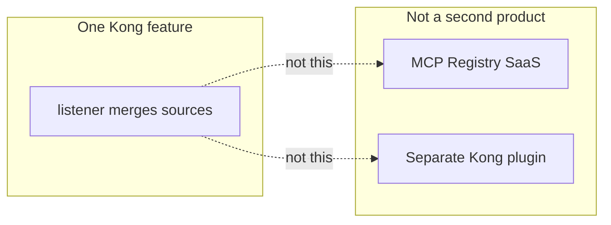

If you already understand **Listener + sources**, you already have the registry; this document explains the **problem that merge solves**, not a new component.

---

**Konnect UI (no “MCP Registry” menu, step-by-step):** **[MCP-KONNECT-UI.md](MCP-KONNECT-UI.md)**

---

## 1. What we mean by “registry” (architecture label)

We are **not** talking about a separate product named “MCP Registry.” In enterprise setups, **registry** means:

- One **discoverable catalog** of tools (`tools/list`) agents may use  
- One **governed entry** (URL + auth + ACL) for clients  
- **Registration** of backends (REST APIs, native MCP servers) without changing every agent config  

In Kong AI Gateway 2.x, that role is played by a **`listener`** MCP Server: it **aggregates** tools from **`sources`** and exposes **one MCP endpoint**.

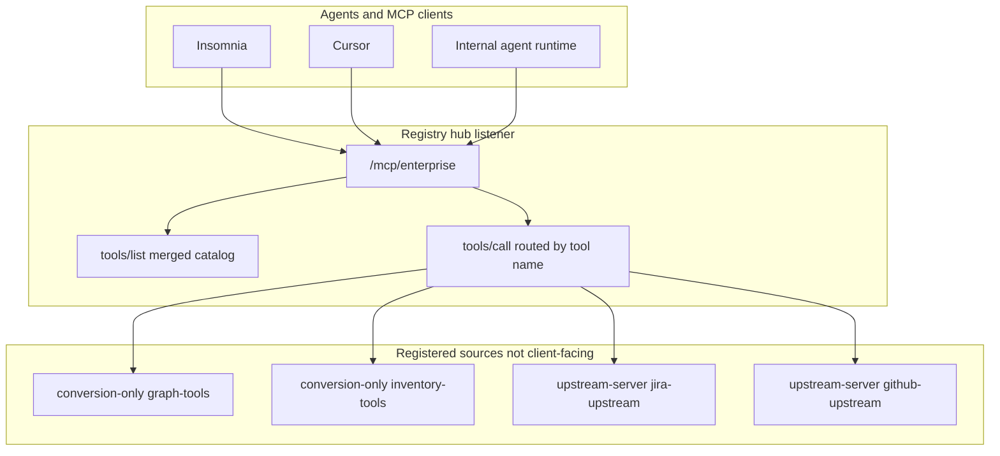

**Registration** = creating or updating a **`conversion-only`** or **`upstream-server`** entity and adding its **`name`** to the listener’s **`sources`** list (usually via platform team PR).

---

## 2. What we did in the playground — and why it was enough *there*

You validated **Conversion Listener** with Petstore:

| What you did | What it proved |
| --- | --- |
| **`type: conversion-listener`** | REST → MCP (`tools/list`, `tools/call`) works |
| One route **`/petstore`** | One URL, one API, tools in YAML |
| Konnect playground 2.2 | Entity model + data plane behavior |

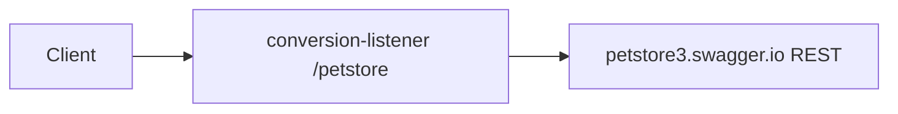

That is the **correct** pattern when:

- **One** REST API (or one bounded integration)  
- **One** team owns tools  
- **One** MCP URL for one use case  

---

## 3. Why the playground approach is not enough at enterprise scale

Petstore-style **Conversion Listener** does **not** solve organizational and operational problems that show up once many teams and systems join.

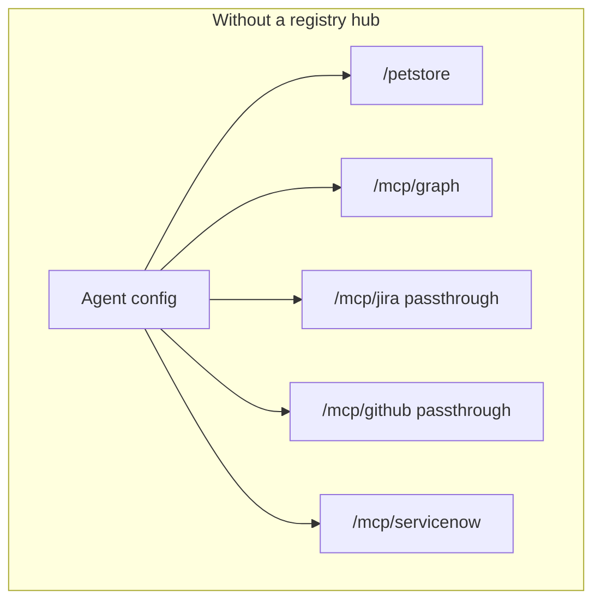

| Gap | Petstore Conversion Listener | Listener registry hub |
| --- | --- | --- |
| **Tool discovery** | One API’s tools only | **Merged** catalog from many sources |
| **Client configuration** | New URL per API | **One** MCP URL |
| **Inbound auth / ACL** | Per route, duplicated policy | **One** policy on the **listener** |
| **Team ownership** | Monolithic MCP server entity | Squads own **`conversion-only`** / **`upstream-server`**; platform owns **listener** |
| **Native MCP teams** | Need **passthrough** per server (more URLs) | **`upstream-server`** registered in **`sources`** |
| **Change control** | Editing one big tool list | Add source + one line in **`sources`** |

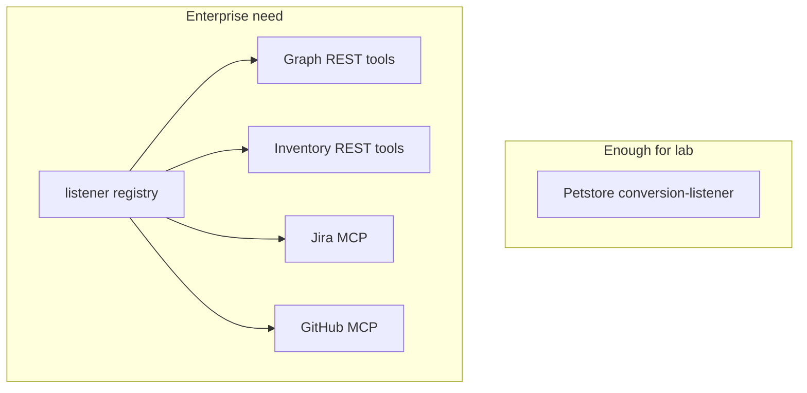

**Summary:** The playground proved **REST→MCP**. Enterprise needs a **catalog and front door** — that is the **Listener + sources** pattern (optionally **mixed** REST and native MCP).

---

## 3b. Two registry recipes — how they fix the same issue

Both rows from the enterprise decision table are the **same registry mechanism**: a **`listener`** with a **`sources`** list. They differ only in **what you register** behind the hub.

| Enterprise need | Pattern name | What goes in `sources` | Without registry (the pain) |
| --- | --- | --- | --- |
| **Jira MCP + GitHub MCP**, one URL | **Upstream Server + Listener** | **`upstream-server`** per native MCP (`jira-upstream`, `github-upstream`) | Two **passthrough** URLs, two agent configs, two auth policies, agent merges tool lists itself |
| **Graph + Jira REST + ServiceNow REST**, one URL | **Conversion Only + Listener** | **`conversion-only`** per REST API (`graph-tools`, `jira-rest-tools`, `servicenow-tools`) | Three **conversion-listener** URLs or raw REST, same sprawl |

**The issue both solve:** agents and Insomnia should not track **N endpoints** and **N catalogs**. The **registry** is the **listener**: one **`tools/list`**, one **`tools/call`** entry point, Kong routes by tool name.

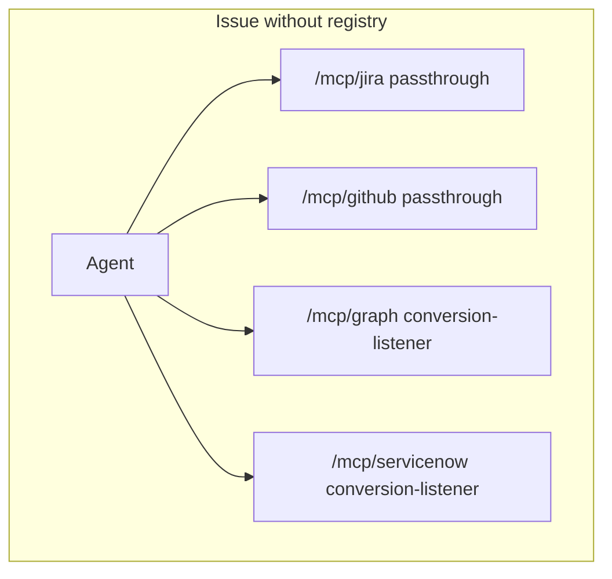

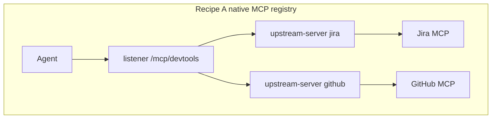

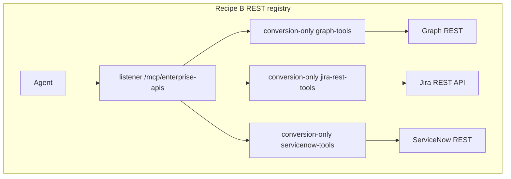

| Registry job | Recipe A (MCP) | Recipe B (REST) |
| --- | --- | --- |
| **Single URL** | `/mcp/devtools` | `/mcp/enterprise-apis` |
| **Single `tools/list`** | Jira + GitHub tools merged | Graph + Jira + ServiceNow tools merged |
| **Register new backend** | Add `upstream-server`, append to `sources` | Add `conversion-only`, append to `sources` |
| **Squads deliver** | Working MCP server URL | REST `tools[]` YAML for their API |

**Why not call it two different products?** Kong still uses **`type: listener`**. “Upstream Server + Listener” and “Conversion Only + Listener” are **documentation shortcuts** for **which source types** you put in the registry—not two hubs.

If you need **both** recipes (Graph REST **and** Jira/GitHub MCP on **one** URL), use **one listener** with **mixed `sources`** — see [AI-GATEWAY-MCP.md §6](AI-GATEWAY-MCP.md).

---

## 4. Why this registry pattern (Listener + sources)

| Alternative | Drawback at scale |
| --- | --- |
| Many **Conversion Listeners** | N URLs, N auth configs, agents must merge tool lists mentally |
| Many **Passthrough** routes | Same for native MCP; no unified ACL on discovery |
| Agents call REST directly | No MCP governance, no tool ACLs, no standard `tools/list` |
| External “registry” SaaS only | Another system; Kong listener keeps **policy on the gateway you already run** |

**Listener as registry** keeps:

- **Discovery** (`tools/list`) centralized  
- **Execution** (`tools/call`) routed to the owning source  
- **Governance** (AI Auth Strategy, tool ACLs) on the hub  

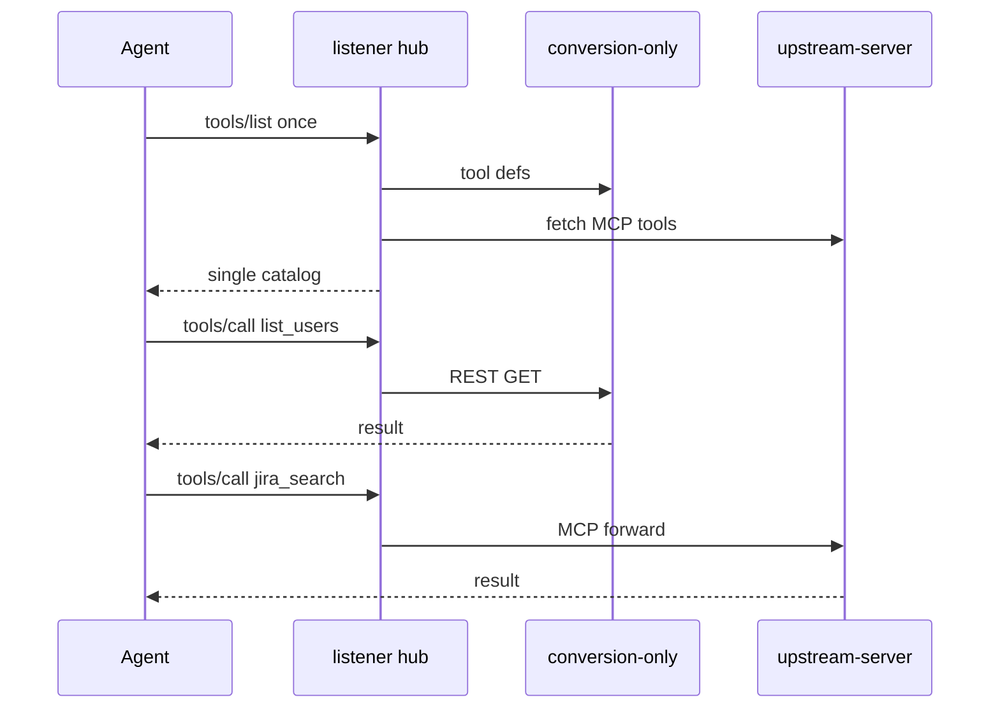

---

## 5. Mixed sources (REST + native MCP on one registry)

When some capabilities are **REST-only** (Microsoft Graph) and others are **already MCP servers** (Jira), the same **listener** registers both:

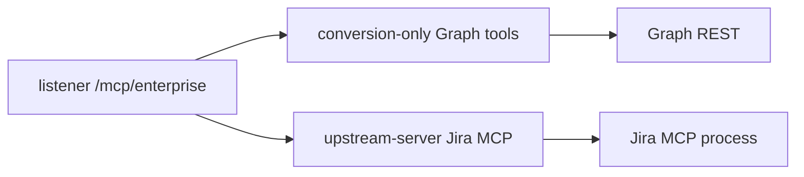

Details and YAML: **[AI-GATEWAY-MCP.md §6](AI-GATEWAY-MCP.md)** (Listener with mixed sources).

---

## 6. Is this possible on on-prem Kong?

**Short answer:** **Partially always; fully depends on deployment shape.**

Kong documents two on-prem realities:

1. **Self-hosted Kong Gateway (decK / OpenShift)** — configuration is **Services, Routes, plugins** (`ai-mcp-proxy`). No Konnect “AI MCP Server” object in Admin API.  
2. **AI Gateway 2.x entity control plane on-prem** (or Konnect CP + your data planes) — same **entity YAML** as the playground; Kong generates primitives.

### Capability matrix (on-prem)

| Pattern | Self-hosted Kong via `ai2kong` / decK | AI Gateway 2.x entity CP on-prem / Konnect |
| --- | --- | --- |
| **Conversion Listener** (one REST → MCP, Petstore) | **Yes** — `ai-mcp-proxy` `conversion-listener` | **Yes** — what you tested |
| **Conversion Only + Listener** (many REST, one URL) | **Yes** — generated plugin topology from entity file | **Yes** |
| **Passthrough Listener** (one native MCP) | **Yes** | **Yes** |
| **Upstream Server + Listener** (aggregate native MCP) | **Limited / no full equivalent** per [Configure AI Gateway on-prem](https://developer.konghq.com/ai-gateway/configure-on-prem/) — **`upstream-server` mode not supported** the same way on plugin-only self-hosted | **Yes** — entity feature (your 2.2 playground class) |
| **Mixed sources** (REST + native MCP on one listener) | **REST portion yes**; **native MCP aggregation** needs entity **`upstream-server`** support | **Yes** when CP supports **`upstream-server`** |

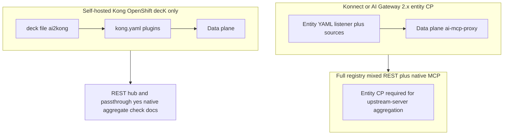

### Practical guidance for OpenShift / on-prem

| Your goal | Recommended path |
| --- | --- |
| Replicate **Petstore** on-prem | **`deck file ai2kong`** from [`petstore-mcp-server-2.1.yaml`](examples/petstore-mcp-server-2.1.yaml) → **`deck gateway sync`** (scoped tags on shared gateway) |
| **Many REST APIs**, one URL | Entity file with **conversion-only** + **listener** → **ai2kong** |
| **One** external MCP | **Passthrough** in decK or entity |
| **Enterprise registry** with **Jira/GitHub MCP + Graph REST** on **one** URL | Plan for **AI Gateway 2.x entity control plane** (Konnect or on-prem CP that supports **`upstream-server`**). Do **not** assume pure decK plugin config replicates full **`upstream-server`** aggregation without verifying your Kong version and [on-prem doc](https://developer.konghq.com/ai-gateway/configure-on-prem/). |

**Workflow on-prem (entity file → decK):**

```bash
deck file ai2kong --source enterprise-mcp.yaml --output-file kong.yaml
# Review generated services, routes, ai-mcp-proxy modes
deck gateway sync kong.yaml   # use select_tags on shared clusters
```

Or one step: **`deck ai sync enterprise-mcp.yaml`** (understand deletion scope for unmanaged config).

---

## 7. Decision path

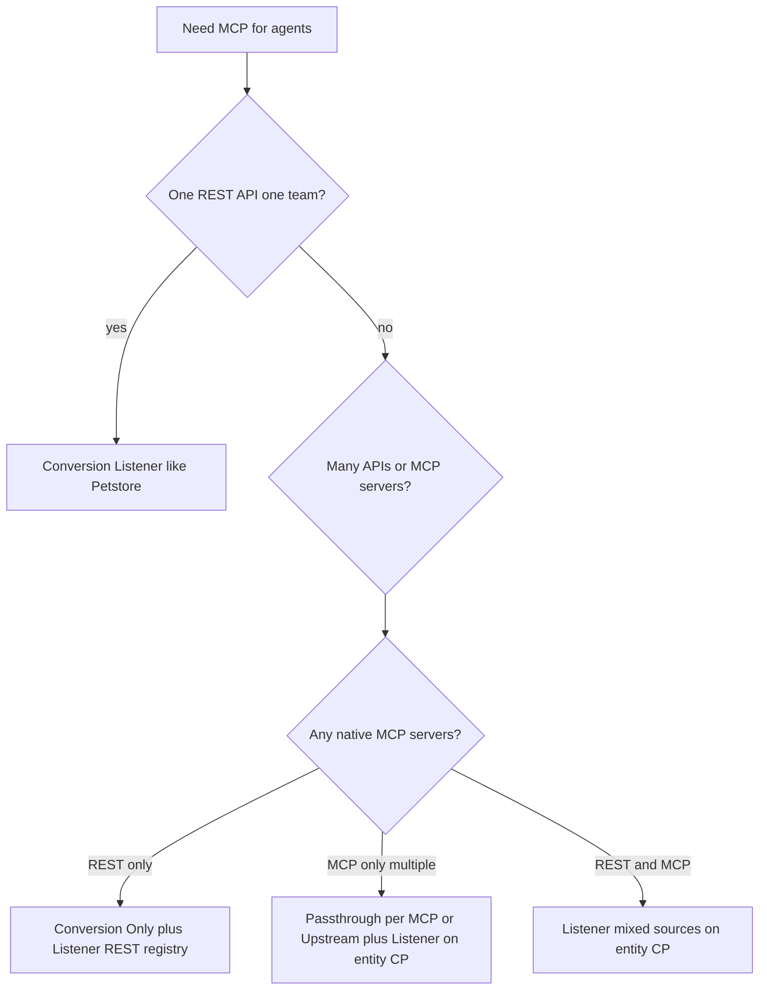

---

## 8. References

- [Kong AI Gateway 2.0: How to Create MCP Servers (YouTube)](https://www.youtube.com/watch?v=_azfxIliMgI) — listener hub + upstream servers in Konnect UI
- [Configure Kong AI Gateway on-prem](https://developer.konghq.com/ai-gateway/configure-on-prem/) — entity → plugin mapping; **`upstream-server`** limitation  
- [AI MCP Server entity — server modes](https://developer.konghq.com/ai-gateway/entities/ai-mcp-server/) — listener aggregation, **`sources`**  
- [deck file ai2kong](https://developer.konghq.com/deck/file/ai2kong/)  
- [AI-GATEWAY-MCP.md](AI-GATEWAY-MCP.md) — five types, mixed sources, passthrough vs listener  
