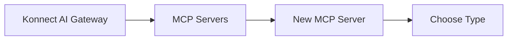
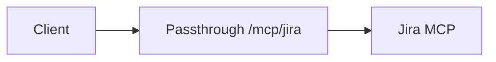
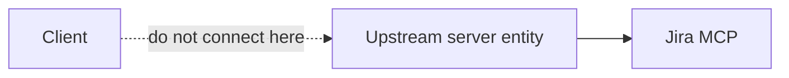
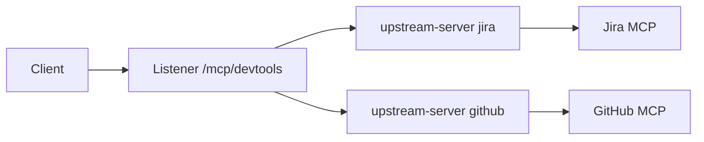
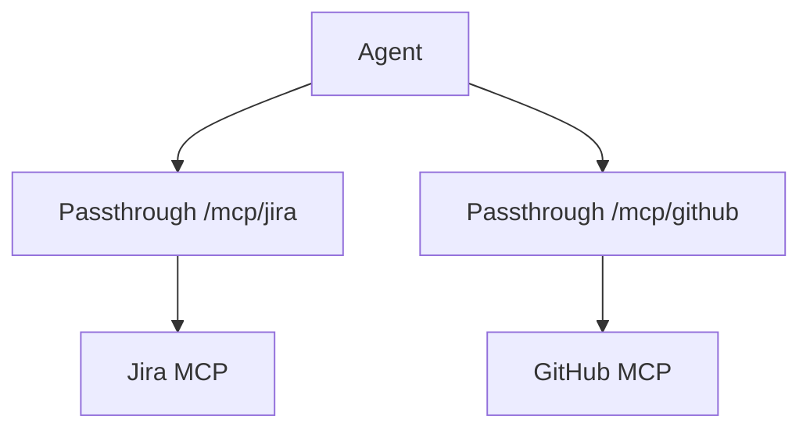
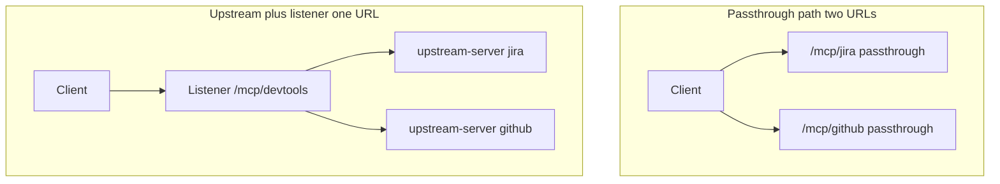
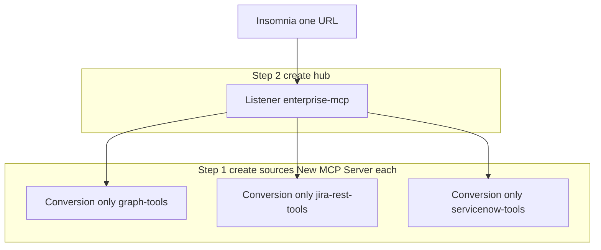
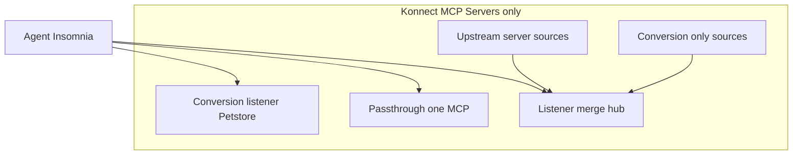

# Kong AI Gateway — MCP in the UI (no separate registry)

Konnect and on-prem **AI Gateway 2.x** do **not** have a product or menu called **MCP Registry**. Merging tools into one URL is **`MCP Servers` → type `Listener` → `Sources`**.

Related: **[AI-GATEWAY-MCP.md](AI-GATEWAY-MCP.md)** (five types, YAML) · **[MCP-ENTERPRISE-REGISTRY.md](MCP-ENTERPRISE-REGISTRY.md)** (why merge at scale; on-prem) · **[examples/petstore-mcp-server-2.1.yaml](examples/petstore-mcp-server-2.1.yaml)** (Conversion listener lab).

---

## Where you click

**Path:** **AI Gateway** → select your gateway → **MCP Servers** → **New MCP Server**

There is no other MCP entry point for creating merge behavior.

---

## Type picker → architecture

| If you need… | Choose **Type** in UI | Client connects to |
| --- | --- | --- |
| One REST API → MCP (Petstore lab) | **Conversion listener** | Route path on that server (e.g. `/petstore`) |
| One existing MCP server, proxy only | **Passthrough listener** | That server’s route path |
| REST tools for a hub (Graph, ServiceNow…) | **Conversion only** | *No direct client URL* — used as a **source** |
| Native MCP for a hub (Jira, GitHub…) | **Upstream server** | *No direct client URL* — used as a **source** |
| **Merge** sources → one catalog + one URL | **Listener** | Listener route path (e.g. `/mcp/enterprise`) |

**“Registry” in our docs** = **Listener + Sources** only (architecture label, not a UI name).

---

## Passthrough listener vs upstream server vs listener

These three are often confused because all involve an **existing MCP server** upstream. They are **different UI types** with different client URLs.

| | **Passthrough listener** | **Upstream server** | **Listener** |
| --- | --- | --- | --- |
| **Role** | **Client-facing proxy** for **one** MCP | **Backend registration** for merge | **Client-facing hub** that **merges** sources |
| **Client connects here?** | **Yes** — its route (e.g. `/mcp/jira`) | **No** — not a public MCP endpoint by itself | **Yes** — its route (e.g. `/mcp/devtools`) |
| **How many upstream MCPs** | Exactly **one** | One per entity (Jira, GitHub, …) | **Many** via **`sources`** |
| **REST → tools?** | No | No | Only if a **`conversion-only`** source is in `sources` |
| **`tools/list`** | From that one upstream (proxied) | Used **by listener** to fetch tools | **Merged** from all `sources` |
| **Typical UI setup** | **One** New MCP Server | **One** New MCP Server per MCP backend | **One** Listener + **Sources** = upstream names |
| **When to use** | Single team, single MCP, no merge | Building block before a **Listener** | Jira **+** GitHub (or more) on **one** URL |

### Passthrough listener (standalone)

One MCP server, one Kong route. Kong forwards MCP bytes; clients never need the upstream URL.

### Upstream server **alone** (not enough for clients)

Registers Jira MCP so a **Listener** can pull its tool list and route calls. Agents should **not** use the upstream-server entity URL as their MCP config (it is not the merge front door).

### Upstream server **+ Listener** (merge native MCPs)

Create **`upstream-server` jira-upstream** and **`upstream-server` github-upstream**, then **`listener`** with **Sources** = both names. Client uses **only** the listener path.

### Passthrough vs upstream + listener (same upstream, different scale)

| Scenario | Use |
| --- | --- |
| **Only Jira MCP**, one URL | **Passthrough listener** — simpler, one entity |
| **Jira + GitHub MCP**, one URL | **Upstream server** × 2 + **Listener** — passthrough × 2 would mean **two** client URLs |

**Rule:** Passthrough = **1:1** client-to-MCP. **Upstream server** = **register for merge**. **Listener** = **where clients connect** when merging.

---

## Multiple passthrough vs listener aggregation (correction)

### Can you run many passthrough MCP servers?

**Yes.** You can create **many** **Passthrough listener** entities (Jira at `/mcp/jira`, GitHub at `/mcp/github`, …). Each is a **separate** client URL and **separate** `tools/list`.

That is **not** aggregation—it is **N front doors**, not one merged catalog.

### Can a listener aggregate passthrough servers?

**No.** **Listener `sources`** may list only **`conversion-only`** and **`upstream-server`** names — **not** **passthrough-listener** (and not **conversion-listener**).

| In **Listener → Sources** | Allowed? |
| --- | --- |
| `upstream-server` (jira-upstream) | **Yes** |
| `conversion-only` (graph-tools) | **Yes** |
| `passthrough-listener` (jira-passthrough) | **No** |
| `conversion-listener` (petstore-mcp) | **No** |

So you do **not** build aggregation by “adding passthroughs to a listener.” You use **`upstream-server`** entries for each native MCP you want in the hub.

### Multiple passthrough **and** a listener (same org)

You **can** have both in one gateway, but they serve **different clients/paths**:

| Config | Client experience |
| --- | --- |
| Passthrough `/mcp/jira` only | Legacy or team-specific direct proxy |
| Listener `/mcp/devtools` with `sources: [jira-upstream, github-upstream]` | **One** URL, merged tools |

Avoid pointing **passthrough** and **upstream-server** at the **same** Jira MCP for the **same** audience unless you intend two entry points (confusing). Pick **passthrough** *or* **upstream + listener** for that backend.

### Then how is passthrough different from upstream-server?

Both talk to an **existing MCP server** upstream. The difference is **who the client connects to** and **whether merge is possible**.

| | **Passthrough listener** | **Upstream server** |
| --- | --- | --- |
| **Client MCP URL** | This entity’s route | **Listener** route (not upstream-server itself) |
| **MCP proxy for clients** | **Yes** — full passthrough | **No** — internal source for listener |
| **In listener `sources`?** | **No** | **Yes** |
| **Merge multiple MCPs** | Only by giving client **multiple URLs** | **Yes**, via **listener** |
| **Entity count for 2 MCPs, 1 URL** | 2 passthroughs (2 URLs) | 2 upstream-servers + 1 listener (1 URL) |

**Same Jira MCP upstream, two patterns:**

- **Passthrough:** Insomnia URL = `https://gateway/mcp/jira` → Kong → Jira MCP.  
- **Upstream + listener:** Insomnia URL = `https://gateway/mcp/devtools` → Kong listener → **routes** to jira-upstream → Jira MCP.

Traffic to Jira may look similar on the wire; **client configuration and tool catalog shape** differ (one catalog vs two; one URL vs two).

---

## Enterprise patterns → UI steps

### A — Graph + Jira REST + ServiceNow REST, one URL

**Conversion only + Listener** (all in **MCP Servers**):

1. **New MCP Server** → **Conversion only** → define `tools[]` + upstream URL for Graph. Note the server **`name`** (e.g. `graph-tools`).
2. Repeat for Jira REST and ServiceNow (`jira-rest-tools`, `servicenow-tools`).
3. **New MCP Server** → **Listener** → route path `/mcp/enterprise-apis` (example).
4. Set **Sources** to: `graph-tools`, `jira-rest-tools`, `servicenow-tools` (exact immutable names).
5. **Insomnia MCP Clients** → URL `https://<gateway>/mcp/enterprise-apis`.

### B — Jira MCP + GitHub MCP, one URL

**Upstream server + Listener**:

1. **New MCP Server** → **Upstream server** → Jira MCP URL → name e.g. `jira-upstream`.
2. **New MCP Server** → **Upstream server** → GitHub MCP URL → `github-upstream`.
3. **New MCP Server** → **Listener** → path e.g. `/mcp/devtools` → **Sources**: `jira-upstream`, `github-upstream`.
4. Clients use only `/mcp/devtools`.

### C — Mixed REST + native MCP on one URL

Same as A + B: create all **conversion only** and **upstream server** sources first, then one **Listener** whose **Sources** lists every name.

---

## What you already did (playground)

| You did | UI type |
| --- | --- |
| Petstore, `get_pet_by_id`, `/petstore` | **Conversion listener** |

No **Listener** and no **Sources** required for that lab.

---

## Catalog ≠ merge

| Feature | Purpose |
| --- | --- |
| **MCP Servers** | Create and configure MCP behavior (including **Listener** merge) |
| **Catalog** (Konnect) | Org-wide **visibility** of MCP servers — not the merged MCP endpoint |

Merged **`tools/list`** always comes from the **Listener** route you configured, not from Catalog.

---

## CLI / on-prem (same model, no extra registry)

| Surface | Command / flow |
| --- | --- |
| Konnect / entity CP | `kongctl apply -f …` with `ai_gateway_mcp_servers` |
| Self-hosted Kong | `deck file ai2kong --source ai.yaml --output-file kong.yaml` → `deck gateway sync` |

Entity types match UI types (`conversion-listener`, `conversion-only`, `upstream-server`, `listener`, `passthrough-listener`).

**On-prem note:** full **upstream server** aggregation may require AI Gateway **2.x entity** control plane; see [Configure AI Gateway on-prem](https://developer.konghq.com/ai-gateway/configure-on-prem/) and **[MCP-ENTERPRISE-REGISTRY.md §6](MCP-ENTERPRISE-REGISTRY.md)**.

---

## Quick reference diagram

---

## Video (Kong official)

- [Kong AI Gateway 2.0: How to Create MCP Servers](https://www.youtube.com/watch?v=_azfxIliMgI) — Konnect **MCP Servers** UI: **upstream server** (DeepWiki, Context7), **listener** aggregation into one path, brief Insomnia demo. Complements the Petstore **conversion listener** lab (REST→MCP is not the focus of this clip).
- [Insomnia v12: MCP Client Debugging & NL Mock Servers](https://www.youtube.com/watch?v=ah5W-JNzOIs) — **Testing MCP in Insomnia**: MCP Clients tab, connect, **tools/list**, **Call Tool**, Params/Headers/Console, OAuth debugging. Use after your gateway route works (Petstore `/petstore` or listener hub URL).

---

## References

- [Aggregate MCP tools from multiple AI MCP Server entities](https://developer.konghq.com/ai-gateway/aggregate-mcp-tools/)
- [AI MCP Server entity](https://developer.konghq.com/ai-gateway/entities/ai-mcp-server/)
- **[MCP-KONG-DOCS-VERIFICATION.md](MCP-KONG-DOCS-VERIFICATION.md)** — local docs checked against official Kong pages
