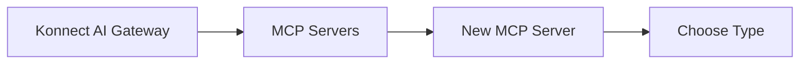
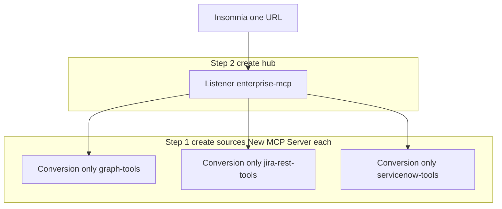
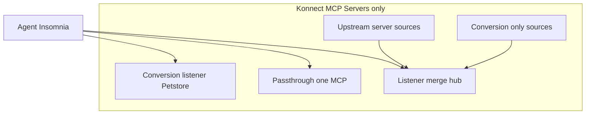

# Kong AI Gateway — MCP in the UI (no separate registry)

Konnect and on-prem **AI Gateway 2.x** do **not** have a product or menu called **MCP Registry**. Merging tools into one URL is **`MCP Servers` → type `Listener` → `Sources`**.

Related: **[AI-GATEWAY-MCP.md](AI-GATEWAY-MCP.md)** (five types, YAML) · **[MCP-ENTERPRISE-REGISTRY.md](MCP-ENTERPRISE-REGISTRY.md)** (why merge at scale; on-prem) · **[examples/petstore-mcp-server-2.1.yaml](examples/petstore-mcp-server-2.1.yaml)** (Conversion listener lab).

---

## Where you click

**Path:** **AI Gateway** → select your gateway → **MCP Servers** → **New MCP Server**

There is no other MCP entry point for creating merge behavior.

---

## Type picker → architecture

| If you need… | Choose **Type** in UI | Client connects to |
| --- | --- | --- |
| One REST API → MCP (Petstore lab) | **Conversion listener** | Route path on that server (e.g. `/petstore`) |
| One existing MCP server, proxy only | **Passthrough listener** | That server’s route path |
| REST tools for a hub (Graph, ServiceNow…) | **Conversion only** | *No direct client URL* — used as a **source** |
| Native MCP for a hub (Jira, GitHub…) | **Upstream server** | *No direct client URL* — used as a **source** |
| **Merge** sources → one catalog + one URL | **Listener** | Listener route path (e.g. `/mcp/enterprise`) |

**“Registry” in our docs** = **Listener + Sources** only (architecture label, not a UI name).

---

## Enterprise patterns → UI steps

### A — Graph + Jira REST + ServiceNow REST, one URL

**Conversion only + Listener** (all in **MCP Servers**):

1. **New MCP Server** → **Conversion only** → define `tools[]` + upstream URL for Graph. Note the server **`name`** (e.g. `graph-tools`).
2. Repeat for Jira REST and ServiceNow (`jira-rest-tools`, `servicenow-tools`).
3. **New MCP Server** → **Listener** → route path `/mcp/enterprise-apis` (example).
4. Set **Sources** to: `graph-tools`, `jira-rest-tools`, `servicenow-tools` (exact immutable names).
5. **Insomnia MCP Clients** → URL `https://<gateway>/mcp/enterprise-apis`.

### B — Jira MCP + GitHub MCP, one URL

**Upstream server + Listener**:

1. **New MCP Server** → **Upstream server** → Jira MCP URL → name e.g. `jira-upstream`.
2. **New MCP Server** → **Upstream server** → GitHub MCP URL → `github-upstream`.
3. **New MCP Server** → **Listener** → path e.g. `/mcp/devtools` → **Sources**: `jira-upstream`, `github-upstream`.
4. Clients use only `/mcp/devtools`.

### C — Mixed REST + native MCP on one URL

Same as A + B: create all **conversion only** and **upstream server** sources first, then one **Listener** whose **Sources** lists every name.

---

## What you already did (playground)

| You did | UI type |
| --- | --- |
| Petstore, `get_pet_by_id`, `/petstore` | **Conversion listener** |

No **Listener** and no **Sources** required for that lab.

---

## Catalog ≠ merge

| Feature | Purpose |
| --- | --- |
| **MCP Servers** | Create and configure MCP behavior (including **Listener** merge) |
| **Catalog** (Konnect) | Org-wide **visibility** of MCP servers — not the merged MCP endpoint |

Merged **`tools/list`** always comes from the **Listener** route you configured, not from Catalog.

---

## CLI / on-prem (same model, no extra registry)

| Surface | Command / flow |
| --- | --- |
| Konnect / entity CP | `kongctl apply -f …` with `ai_gateway_mcp_servers` |
| Self-hosted Kong | `deck file ai2kong --source ai.yaml --output-file kong.yaml` → `deck gateway sync` |

Entity types match UI types (`conversion-listener`, `conversion-only`, `upstream-server`, `listener`, `passthrough-listener`).

**On-prem note:** full **upstream server** aggregation may require AI Gateway **2.x entity** control plane; see [Configure AI Gateway on-prem](https://developer.konghq.com/ai-gateway/configure-on-prem/) and **[MCP-ENTERPRISE-REGISTRY.md §6](MCP-ENTERPRISE-REGISTRY.md)**.

---

## Quick reference diagram

---

## References

- [Aggregate MCP tools from multiple AI MCP Server entities](https://developer.konghq.com/ai-gateway/aggregate-mcp-tools/)
- [AI MCP Server entity](https://developer.konghq.com/ai-gateway/entities/ai-mcp-server/)
